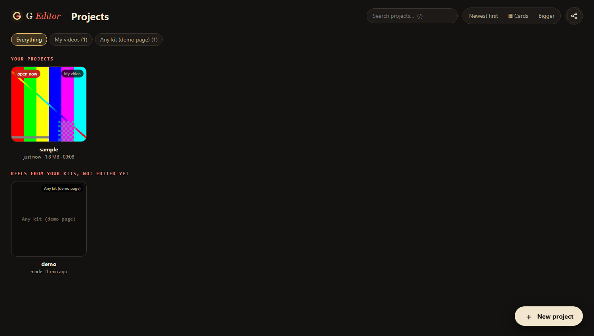
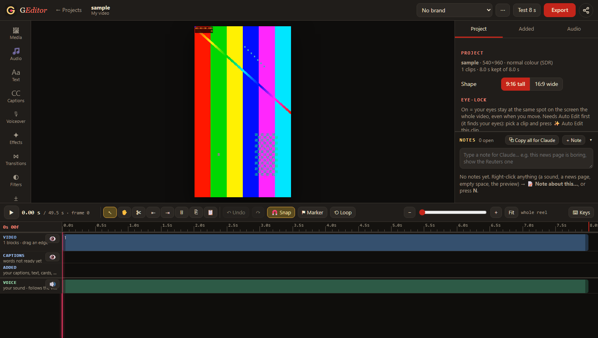

# GEditor

**A video editor that opens in your browser, runs on your own computer, and also opens on your phone or Mac over the same Wi-Fi.**
Made for talking-head reels: drop in a phone video and GEditor cuts the pauses, adds zooms, keeps your eyes steady, writes the captions, and lets you change every piece on a timeline like Premiere / CapCut / Instagram Edits.

*GEditor by GauthamWho. Free to use and build on. See [LICENSE](LICENSE).*

## What you get
- **Projects page + New project**: pick a video, drag one in, or use the `Inbox` folder. Choose **Auto Edit** (cuts + zooms) or **Plain** (the whole video, edit by hand). 9:16 or 16:9.
- **Auto Edit** (your pauses cut, slow zoom in/out, caption words from your voice) and **Eye-Lock** (your eyes stay at one spot on screen). Both can be switched on or off any time, per clip.
- **Timeline like the big editors**: video, captions, added things and sound on rows; click to pick, drag edges, split, delete, undo, snap, markers, loop, zoom, touchpad and touch gestures, keyboard shortcuts.
- **Captions** with looks you can change (colour, size, font, extend either side), a safe-zone guide, filters, adjust, effects, transitions, speed.
- **Cut me out**: you (and what you hold: mug, phone, pen) without the background. Exports a folder: background video, you with a see-through background, you on green, and the mask.
- **Export** MP4 at the size and frame rate you pick; SDR or HDR (HDR keeping your iPhone light needs the full ffmpeg, see below).
- **Share button** (top right): the Wi-Fi link to open the same GEditor on your phone, Mac or laptop.
- **Notes + AI door**: leave notes on any part of the reel; any AI app that speaks MCP (see `mcp_server.py` and `AI-GUIDE.md`) can read the notes and edit the reel.

## Install (one click)
You need nothing but **Python 3.9 or newer** ([python.org](https://www.python.org/downloads/); on Windows tick "Add python.exe to PATH").

| | Windows | Mac |
|---|---|---|
| 1 | Download this repo (green **Code** button, **Download ZIP**) and unzip it | same |
| 2 | Double-click **`setup_windows.bat`** | Double-click **`setup_mac.command`** (first time: right-click, Open) |
| 3 | Wait about 5-10 minutes. It makes a private `.venv` folder, installs the Python parts, offers to install ffmpeg (winget / Homebrew), and a small caption-drawing browser | same |
| 4 | Double-click **`Start_GEditor.bat`** | Double-click **`Start_GEditor.command`** |

Nothing is installed outside this folder except ffmpeg (and only if you say yes). The cut-out models (about 400 MB) and the caption-voice model download once, the first time you use those tools.

## Use it on two devices
1. Start GEditor on one computer (the one that holds the videos). Keep it on.
2. Open the **Share** button (top right) and copy the Wi-Fi link.
3. Open that link in the browser of your phone, Mac or laptop on the same Wi-Fi. Same projects, same files (they stay on the first computer).
4. If the link does not open on Windows, allow Python through the Windows firewall for **Private** networks when it asks.

## Good to know
- **HDR / iPhone light**: for an SDR copy that keeps the Dolby Vision look, GEditor uses an ffmpeg build with `libplacebo` (full build). Put it at `ffmpeg-full/bin/ffmpeg.exe` or set `GEDITOR_FFMPEG_FULL`. Without it, normal videos export fine; HDR clips give the HDR file only.
- **Speed**: Cut me out is slow on an old PC (about 1 s a frame per model); much faster on an Apple-chip Mac or a PC with free memory.
- **Not included** in this public copy: the Blueprint / SKY / Notebook / other private kit pages and Theatre.js's separate "studio" editor.
- Your projects live in `projects/` and your videos in `Inbox/` (both are ignored by git).

## Licence in one line
Use it free, change it, build on it, edit your own paid videos with it. Keep the name **GEditor** and the credit **GauthamWho**. Selling GEditor, or an app or service built from it, needs a paid deal with the author. Third-party parts keep their own licences: [NOTICE.md](NOTICE.md).
